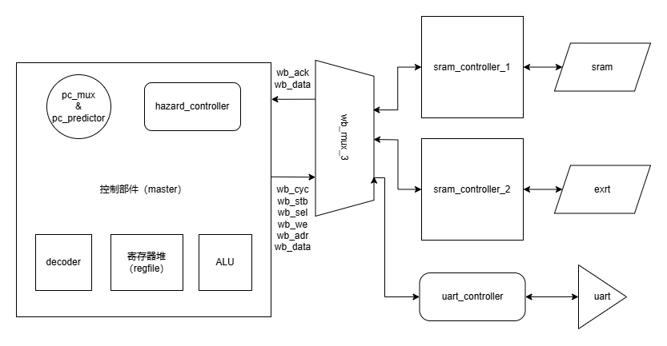
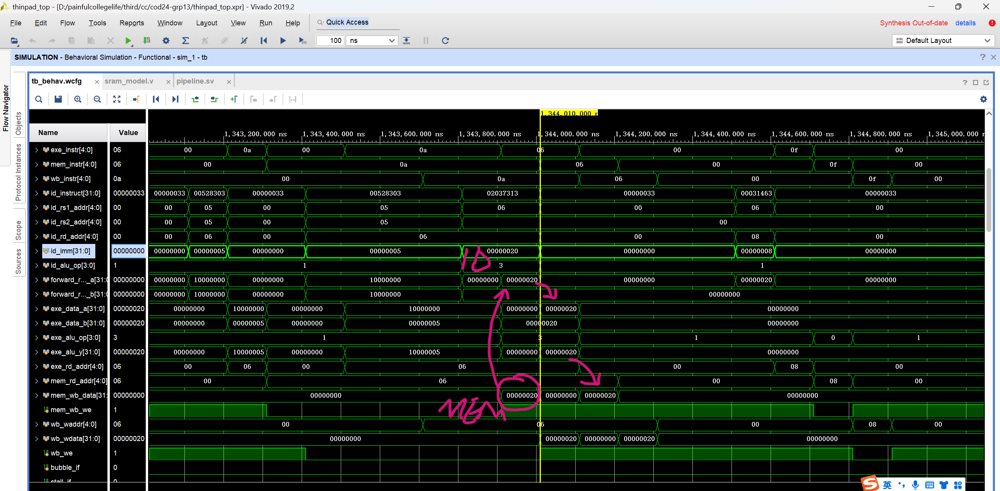
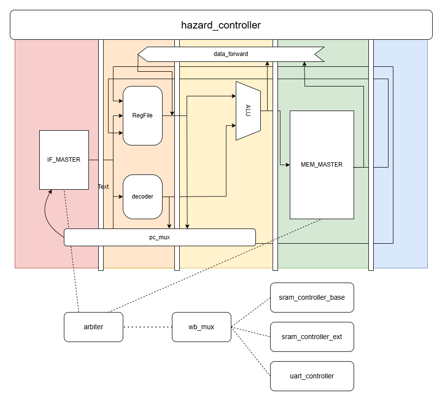
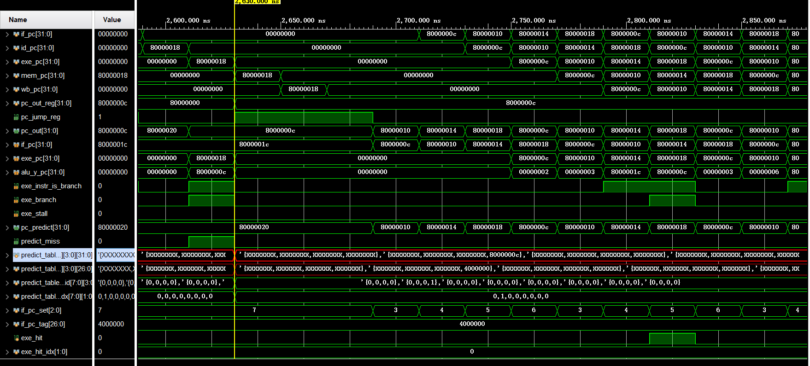
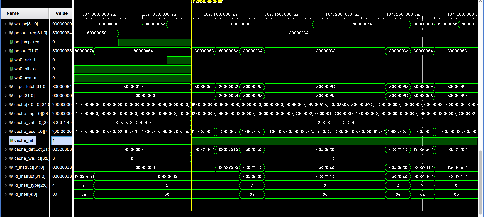
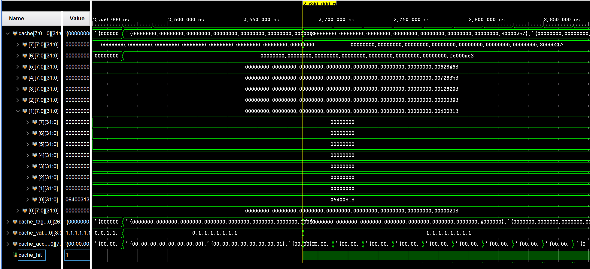
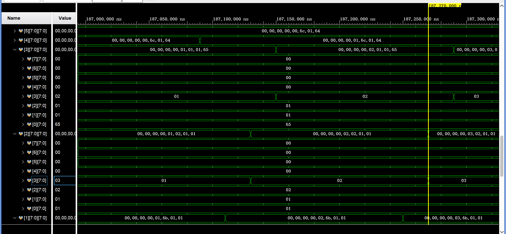
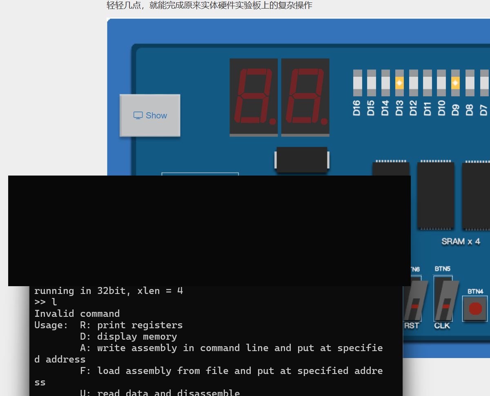
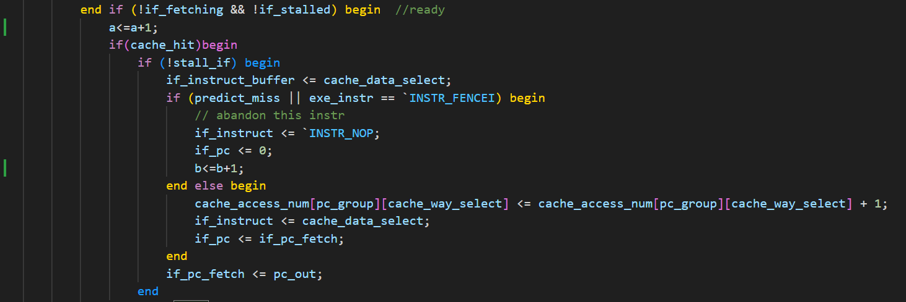
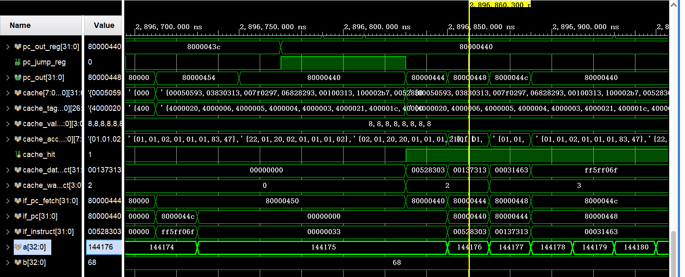

# RV32I 五级流水线处理器设计报告

## 一、实验目标

设计五级流水线cpu，能够运行基础版本的监控程序和新增三条扩展指令。使用指令缓存和分支预测优化性能。

## 二、实验内容

### cpu结构图



### 模块介绍：

- `decoder.sv/Decoder`：将指令解码为控制信号，输出指令类别、操作数、立即数和 ALU 操作码。
- `alu.sv/ALU` 与 `regfile.sv/regfile`：负责算术逻辑运算和寄存器读写。
- `pc_mux.sv/pc_mux` 与 `pc_mux.sv/pc_predictor`：选择下一 PC，并提供预测地址和预测失败信号。
- `hazard_controller.sv/hazard_controller`：处理冲突、停顿和流水线冲刷。

1. 内存RAW冲突
2. 读取指令和访问内存时向流水装填气泡
3. 分支预测错误时的flush操作

输出各阶段的bubble和stall信息
- `pipeline.sv/pipeline`：例化上述子模块，维护 IF/ID/EX/MEM/WB 阶段寄存器、数据前传、冲突控制和指令缓存。

#### 数据前传

```verilog
always_comb begin
    // 目标寄存器是zero，直接返回0
    if (id_rs1_addr == 5'b0) begin
        forward_rdata_a = 5'b0;
    // exe阶段刚计算完的值向前传递到id阶段，分为一般情况和跳转指令（使用alu计算目标地址传递给pc_mux）
    end else if(exe_instr_type != `INSTR_S && exe_rd_addr == id_rs1_addr) begin
        if (exe_instr_type == `INSTR_J) begin
            forward_rdata_a = exe_pc + 4;
        end else begin
            forward_rdata_a = exe_alu_y;
        end
    // 在mem阶段，还未进入wb阶段写回的值传递给id阶段
    end else if(mem_wb_we && mem_rd_addr == id_rs1_addr) begin
        forward_rdata_a = mem_wb_data;
    // 在wb阶段，还未写回的值传递给id阶段（寄存器写是时序逻辑，在本阶段完成时才写入）
    end else if(wb_we && wb_waddr == id_rs1_addr) begin
        forward_rdata_a = wb_wdata;
    // 无数据冲突，不需要数据前传，直接传递寄存器堆中的值
    end else begin
        forward_rdata_a = rf_rdata_a;
    end
end
```

##### 示例

```asm
.TESTW:
    lb t1, %lo(COM_LSR_OFFSET)(t0)  // 查看串口状态
8000039c:	00528303          	lb	t1,5(t0) # 10000005 <INITLOCATE-0x6ffffffb>
    andi t1, t1, COM_LSR_THRE       // 截取写状态位 
    //此处查看t1的值但上一条指令lb还在mem阶段，刚刚从串口中取到值但还未写入，发生数据前传，无需向流水线中插入气泡。
800003a0:	02037313          	andi	t1,t1,32
    bne t1, zero, .WSERIAL          // 状态位非零可写进入写
800003a4:	00031463          	bnez	t1,800003ac <.WSERIAL>
    j .TESTW                        // 检测验证，忙等待
800003a8:	ff5ff06f          	j	8000039c <.TESTW>
```


其他与串口、访问内存相关的模块：串口控制器线master、总线slave、仲裁器等。

### 数据流图


通过传递对应的状态寄存器值作为输入，可以保证pc_mux、hazard_controller、regfile和dataforward等模块和功能在预期的状态按照预期行为工作

### 扩展功能

#### 分支预测

##### 实现原理

通过一个组相联表来进行分支预测，8组4块，为寄存器形式，通过指令PC的第5到3位（低位，即 `pc[4:2]`）来作为组号，更新方法采用FIFO。表中存储发生跳转时的当前 pc 和 下一 pc 以及有效性等信息，检查预测表是否命中，命中则取表中值，否则默认下一条指令地址为当前指令 pc + 4，此预测以类似组合逻辑的方式提供给 `IF`阶段。同时，对于 `EXE`阶段的指令，此时可以判断其下一条指令的地址，在此时检查预测是否正确，若正确则正常继续，否则冲刷流水线，与未实现预测时发生跳转的逻辑相同。若发生预测失败，则更新预测表到最新，覆盖对应组中最老项或更新已存在项，此部分需写表（寄存器），为时序逻辑。

##### 改进效果

没有仅对比指令预测的版本，此处为与 `icache`联用的效果展示。

###### 仿真结果


如图，在发生预测错误（此处为指令需要跳转，表中无对应项而默认预测为+4）时，预测表更新并发生流水线冲刷。而后面则通过指令缓存和分支预测的联合使用实现了密集的流水线执行，提高最高IPC到1。

###### 性能对比

| test         | 1PTB    | 2DCT    | 3CCT    | 4MDCT   | CRYPTONIGHT |
| ------------ | ------- | ------- | ------- | ------- | ----------- |
| base         | Timeout | 24.159s | Timeout | Timeout | 2.286s      |
| icache & BTB | 6.711s  | 13.757s | 5.369s  | 20.133s | 1.846s      |

同为 50MHz 时钟，性能测试中基线版本仅通过 `2DCT`和 `CRYPTONIGHT`，分别为 24.159s 和 2.286s ，而拥有分支预测和指令缓存的版本所有测试未超时，在 `2DCT`和 `CRYPTONIGHT`上表现分别为 13.757s 和 1.846s，而在 `1PTB`中用时仅为 6.711s，可见其对简单循环有极高的优化效果。

#### 指令缓存icache

##### 实现原理

使用8x8的组相连表存储缓存块。
对于每一个if阶段涉及的取指令32位地址if_pc_fetch，其高26位if_pc_fetch[31:5]作为tag，而if_pc_fetch[4:2]表示组号。
维护icache相关数组：

```sv
logic [DATA_WIDTH-1:0] cache[7:0][7:0];// cache[i][j]表示第i组第j个cache块的数据
logic [26:0] cache_tag[7:0][7:0];// cache_tag[i][j]表示第i组第j个cache块的tag
logic [3:0] cache_valid_num[7:0];// cache_valid_num[i]表示第i组有效cache块的数量
logic [7:0] cache_access_num[7:0][7:0];// cache_access_num[i][j]表示第i组第j个cache块的访问次数
```

维护相应的状态变量：

```sv
logic [26:0] pc_tag;// 当前pc的tag
logic [2:0] pc_group;// 当前pc的组号
logic cache_hit;// 是否命中缓存
logic [DATA_WIDTH-1:0] cache_data_select;// 命中缓存的数据
logic [3:0] cache_way_select;// 命中缓存的组
logic [3:0] min_access_way[7:0];// min_access_way[i]=j: 第i组的第j个cache块的访问次数最小
logic [DATA_WIDTH-1:0] data_select;// 待写入的数据
```

使用组合逻辑遍历icache，通过比对group和tag来判断当前是否命中缓存，并更新cache_hit、cache_data_select等相关变量的值；通过比较min_count和cache_access_num来确定当前状态下每个每个组中被访问次数最少的缓存块的下标，并更新min_access_way数组的值。
在if阶段，如果命中缓存，则直接从cache_data_select中读取数据；如果未命中缓存，则需要进行wishbone请求，从相应地址读取数据，并将其写入icache中，即更新cache、cache_tag、cache_access_num等相关数组的值。此外，在写入时需要注意，若当前组的缓存项未满，则直接写入，并更新cache_valid_num；若当前组的缓存项已满，则新写入的数据需要覆盖该组中被访问次数最少的缓存块的数据，即使用LRU缓存替换策略进行缓存数据更新。

##### 功能实现原理波形图




使用

```
../../asmcode/5.bin:     file format binary


Disassembly of section .data:

80000000 <.data>:
80000000:	00000293          	li	t0,0
80000004:	06400313          	li	t1,100
80000008:	00000393          	li	t2,0
8000000c:	00128293          	addi	t0,t0,1
80000010:	007283b3          	add	t2,t0,t2
80000014:	00628463          	beq	t0,t1,0x8000001c
80000018:	fe000ae3          	beqz	zero,0x8000000c
```

进行仿真，可以看到当重复取到8000000c、80000010、80000014等地址的指令时，由于该地址的tag已经在cache_tag中，所以命中缓存，直接从cache_data_select中读取数据，而不进行wishbone请求。并且能看到每一次取指令都会伴随着相应cache_access_num的值的增加。

##### 性能数据对比

与分支预测一同测试，见于“扩展功能-分支预测-改进效果-性能对比”一节

## 三、效果展示


与本地term连接后进入与监控程序的交互。

## 四、总结与思考

### 思考题

#### 1.流水线cpu&数据旁路

由于流水线cpu中一次可容纳五条指令执行，因此在每一时刻并不存在一个特定状态，每一个周期都是独立同时钟工作。对于多周期cpu，每一个周期的执行都需等待上一个周期，cpu进入本状态才开始。
数据旁路能够将计算完成（EXE）但尚未写入寄存器（WB）的数据“提前”传递给后续指令，能够节省1-3个周期，否则需要向流水线中填充气泡，等待数据写入寄存器后执行。

#### 2.Flash

Flash在程序中应当预先规定了一个固定的地址区间，在将Flash上固定位置的监控程序读入内存时，应当在最开始首先初始化开始读的地址。可以在当前cpu中实现一个引导加载程序，用于设置初始地址，并初始化相应信号，引导加载程序在执行完必要的初始化后，通过跳转指令将控制权交给Flash中的监控程序。

#### 3.DVI

视频输出需要将对应画面逐行发送到对应接口上，一个周期发送一个像素的RGB信息，用 `hdata`和 `vdata`来控制移位，通过 `hsync` `vsync`等信号来同步发送的信号。通过将此接口连接到显存上，CPU可以通过总线访问显存来修改显示画面。如果要在屏幕上显示文字，则CPU可以通过向显存写入文字所对应的图像信息来完成。

#### 4.分支预测

如果不实现分支预测，仅实现指令缓存，则目标循环每执行四次指令就可能发生多次跳转；每次控制流重定向都会冲刷更年轻的指令，限制 IPC。实现预测表后，稳定循环中的取指路径可以接近每个周期一条指令。原始测试中，优化版本在 5.369 s 内完成 `3CCT`，而基线版本未在测试时限内完成；由于没有“仅缓存”的中间基线，不能把这个结果精确归因或换算成固定倍数。

#### 5. 指令缓存

如果不实现指令缓存，每次 IF 阶段取指令都需要等待一次 Wishbone 访存事务，会显著拉长取指路径。指令缓存命中时可以直接从片上寄存器阵列返回指令，仅在 miss 时发起总线请求。

原始报告曾把仿真计数器 `a`、`b` 误写成“总取指次数”和“缓存命中次数”。核对 `pipeline.sv` 后可确认：`a` 统计取指事件，而 `b` 统计预测失败或 `FENCE.I` 触发的重定向事件，因此 `68 / 144176` 不能被解释为缓存命中率。公开版保留这组波形作为预测失败计数的实现证据；精确缓存命中率需要新增独立计数器并通过受控实验测量。




在原始性能测试中，加入指令缓存和分支预测的版本能够在 20.133 s 内完成 `4MDCT`，而基线版本未在测试时限内完成。由于缺少“仅缓存”和“仅预测”的中间基线，不能把这组结果拆分成单一优化项的贡献。

### 工程反思

本项目把流水线控制、主机与从机总线、外设访问和性能优化放在同一条可运行路径上。实现过程中最有价值的部分不是单个模块，而是确认 IF/ID/EX/MEM/WB 之间的控制信号、暂停条件和冲刷条件能够在同一时序模型内协同工作。指令缓存和预测表只有在与访存握手、重定向和 `FENCE.I` 保持一致时，才会真正转化为性能收益。

### 模块整合中的困难与解决方案

模块最初分别开发，接口时序和信号语义并不完全一致。整合时通过阶段边界表、逐级波形检查和最小复现用例，定位预测重定向、访存等待和数据前传之间的耦合问题，再统一到同一条流水线控制路径中。
